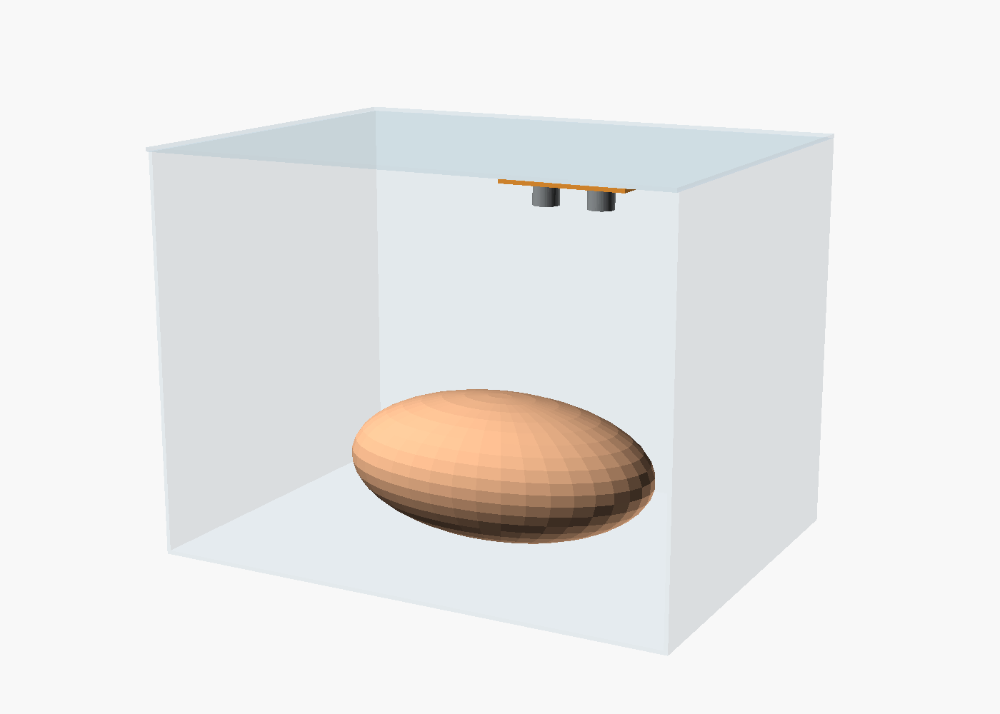
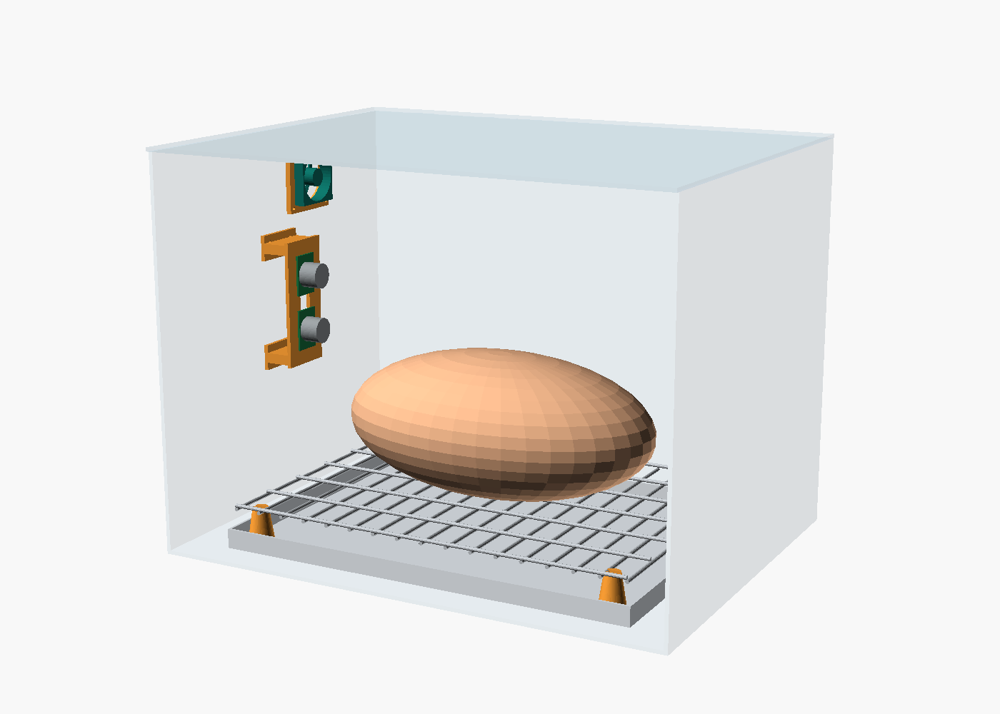
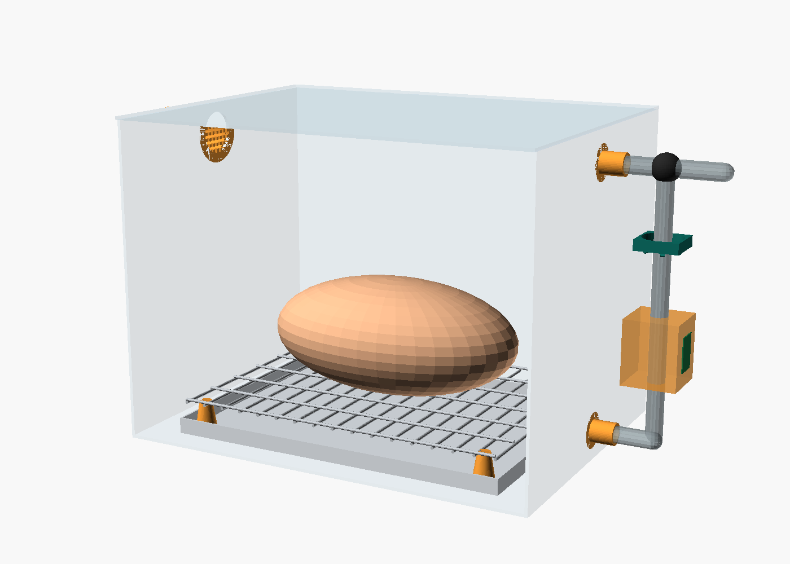
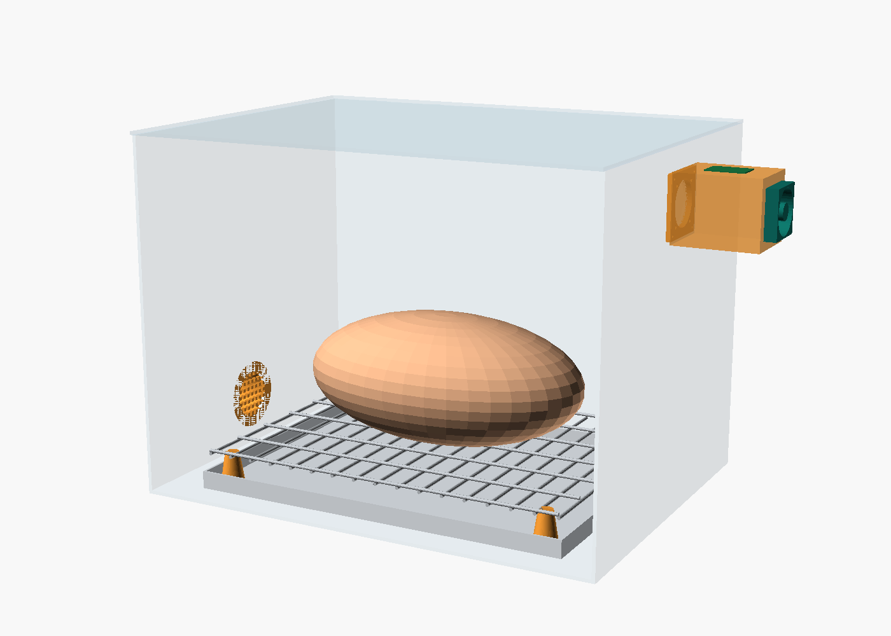
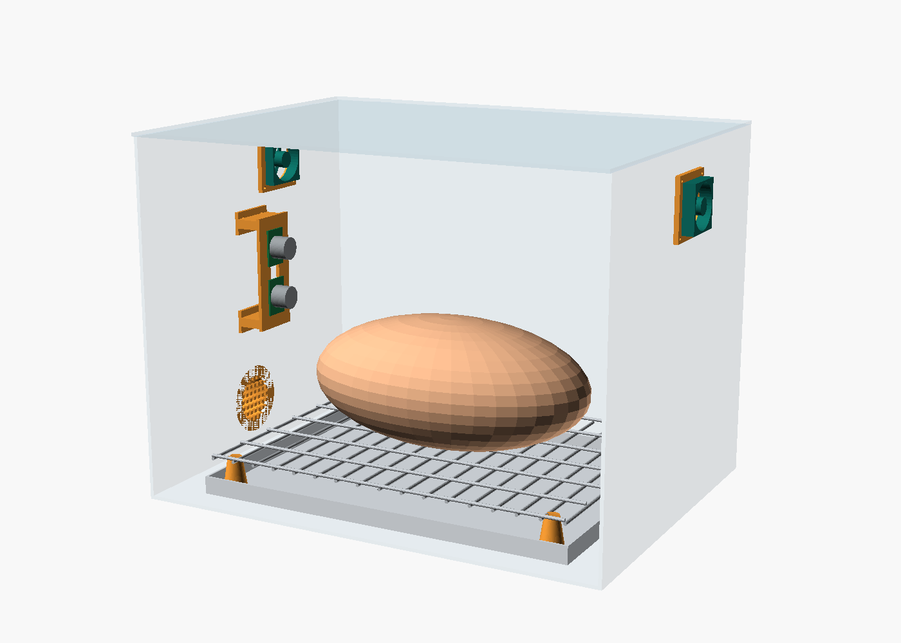
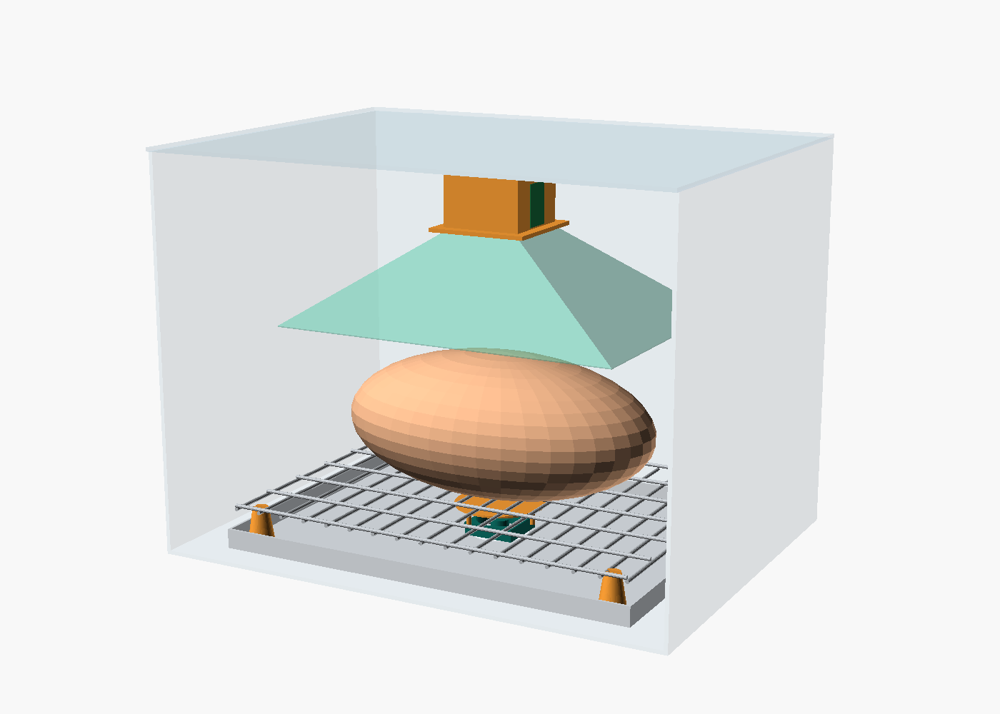
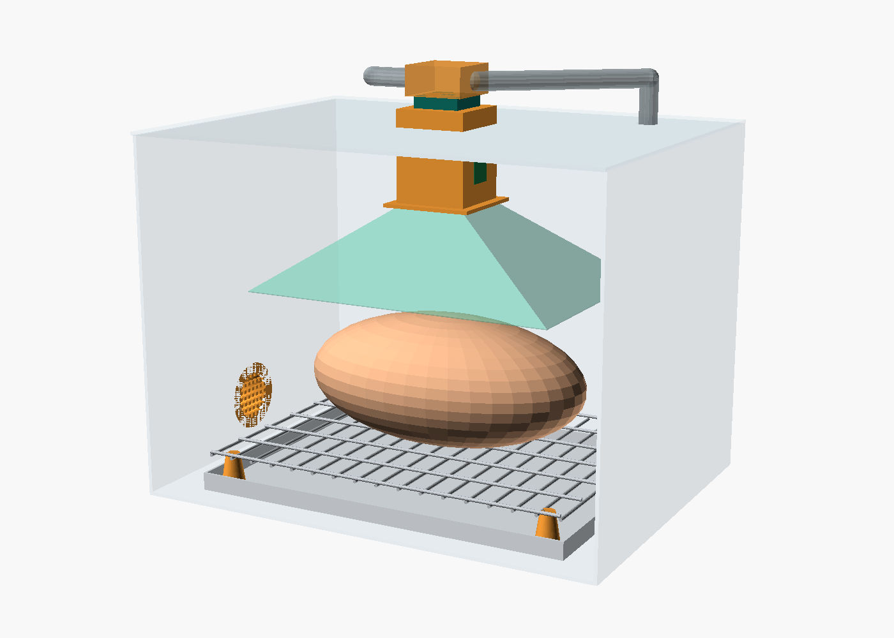

# Sensor box v2: 3D model

A parametric OpenSCAD model of the seven sensor-box layouts from the airflow study,
plus the parts to 3D-print or cut. The letters match `airflow-sim.html` (open it in a
browser to watch the airflow of each layout).

| File | What it is |
|---|---|
| `box_v2.scad` | The model. One file, every design and every printable part. Change `design` / `part` and the sizes at the top |
| `render/design_*.png` | A picture of each layout (front wall hidden) |
| `render/part_*.png` | Pictures of the main printed parts |
| `stl/*.stl` | Ready-to-print parts at the default sizes |
| `hood_net.svg` | Cutting template for the V-hood (E, F), 1:1 in mm |
| `airflow-sim.html` | Interactive 3D airflow simulation of all seven layouts |

## Box size (recommended)

**Inside 400 × 300 × 300 mm (about 36 L)**: a clear PP storage box with a flat, clip-on lid.

- It fits a whole 1–1.2 kg chicken (model: 250 × 150 × 110 mm) on a 30 mm rack, with
  25 mm of air above it, a 70 mm V-hood and the throat collar under the lid.
- **Trade-off:** a bigger box dilutes the smell. In the "hold" layouts (NOW, A, D) the
  ratio moves less than in your current box. F does not suffer much, because the hood
  sends the chicken's air straight to the sensors.
- **Only building A or D?** A smaller box (about 350 × 250 × 250 mm) gives a stronger
  signal. Change `box_L`, `box_W`, `box_H` and everything else follows.
- **Measure your real box** and put its inside size into `box_L`, `box_W` and `box_H`
  before printing anything that depends on it.

## The seven layouts

| Design | Picture | Fan | Sensors | Purge |
|---|---|---|---|---|
| **NOW** still box |  | none | under the lid | open the lid |
| **A** stir fan |  | 40 mm, top-left corner, blowing along the lid | left wall, 55 % height (165 mm), 25 mm standoff | open the lid |
| **B** side loop |  | 40 mm in the riser tube, after the sensors | chamber on the tube outside the right wall | tee valve to outside + carbon filter (left wall, high) |
| **C** through-flow |  | 40 mm on the end of the sensor chamber | chamber outside the high outlet (right wall) | automatic: filter inlet low on the left wall |
| **D** hold · mix · flush |  | stir fan (like A) + exhaust fan outside the high outlet | left wall, like A | exhaust fan + filter inlet low on the left |
| **E** fan under + V-hood |  | 40 mm on the floor under the rack, blowing up, with a drip shield | in the hood throat collar | open the lid |
| **F** V-hood chimney |  | 40 mm on top of the collar, above the lid, after the sensors | in the hood throat collar, about 274 mm high | flap box on the fan → outside, filter inlet low on the left |

**Build order:**

1. **D first.** It keeps your current 5-minute hold, so the new data stays close to the
   data you already have.
2. **Then F.** It gives the best signal and works like the handheld sniffer.

## Key heights (default model, from the inside floor)

| What | Height / size |
|---|---|
| Rack grid | 30 mm (rod 3 mm), on 4 printed feet, drip tray 15 mm under it |
| Chicken top | ~143 mm |
| V-hood mouth | 168 mm high, 270 × 190 mm opening |
| Hood top / throat | 238 mm, square throat 56 mm inside |
| Sensors in the collar | F ≈ 274 mm · E ≈ 258 mm. Two MQ cans on opposite walls, DHT11 on a third |
| Side-wall sensors (A, D) | 165 mm (55 % of the height), 25 mm off the wall |
| Filter inlet (C, D, F) | Ø 41 mm hole, centre 45 mm high, left wall |
| Outlet (C, D) | Ø 38 mm hole, centre 45 mm below the lid, right wall |
| Lid opening (F) | 61 × 61 mm for the collar + Ø 20 mm for the return tube |

## Printed parts (`stl/`)

PETG is best (food smell, warmth near the MQ heaters). PLA works away from the
sensors. Use 3 walls, 20 % infill.

| Part | For | Qty | Notes |
|---|---|---|---|
| `throat_collar.stl` | F | 1 | Holds both MQ cans + DHT11, fan plate on top. Print upside down (fan plate on the bed); the 8 mm bottom flange needs supports |
| `throat_collar_E.stl` | E | 1 | Shorter, open top, no fan plate |
| `sensor_wall_mount.stl` | NOW, A, D | 1 | Print flat. M2 screws for the MQ boards, M3 into the wall |
| `rack_foot.stl` | all except NOW | 4 | Lifts a kitchen cooling rack to 30 mm. The slot grips a 3 mm rod |
| `filter_port.stl` | B, C, D, F | 1 | Fill with activated-carbon granules. Glue through a 41 mm hole. A push-in cap closes it during the hold |
| `tube_port.stl` | B | 2 | For 16 mm silicone tube through a 20 mm hole |
| `fan_mount_40.stl` | A, C, D | 1–2 | Holds a 40 mm fan over a 38 mm hole |

**V-hood (E, F):** cut the 4 panels in `hood_net.svg` from 0.5–1 mm PET or PP sheet.

1. Print at 100 % scale and check one panel with a ruler.
2. Tape the slanted edges together.
3. Glue the top tabs under the collar flange.

A cut plastic bottle also works for a quick test: the neck becomes the throat.

## Other parts per design

| Part | NOW | A | B | C | D | E | F |
|---|---|---|---|---|---|---|---|
| Stainless cooling rack ~320 × 240 + drip tray | | ✓ | ✓ | ✓ | ✓ | ✓ | ✓ |
| 40 × 40 × 10 mm 5 V fan | | 1 | 1 | 1 | 2 | 1 | 1 |
| Logic MOSFET (IRLZ44N) + 1N4007 diode + 10 kΩ, per fan | | ✓ | ✓ | ✓ | ✓ | ✓ | ✓ |
| Activated-carbon granules | | | ✓ | ✓ | ✓ | | ✓ |
| 16 mm silicone tube + 3-way valve | | | ✓ | | | | |
| PET/PP sheet 0.5–1 mm (hood) | | | | | | ✓ | ✓ |
| Small flap or cap to switch loop / flush | | | ✓ | | ✓ | | ✓ |

## Rules that come with any new box

- **Fans run the same way in the baseline and the sample.** Moving air cools the MQ
  heater and changes the reading on its own.
- **Run fans slowly and steadily** (PWM about 30–50 %), especially through the narrow throat.
- **New box = new dataset version.** Put `"method": "box_v2_D"` (or `_F` …) in the JSON
  `notes`. Run the first chickens in both the old and the new box.
- **Chicken in the same spot** every time: centre of the rack, same side up.

## Editing and exporting

```
# open the model (Customizer: Window > Customizer)
openscad hardware/box_v2/box_v2.scad

# picture of one layout
openscad -o render/design_F.png --imgsize=1400,1000 --colorscheme=Tomorrow \
  --camera=0,0,140,76,0,28,1350 -D 'design="F"' box_v2.scad

# one printable part
openscad -o stl/throat_collar.stl -D 'part="throat_collar"' box_v2.scad

# hood template
openscad -o hood_net.svg -D 'part="hood_net"' box_v2.scad
```

All sizes are in millimetres and live at the top of `box_v2.scad`: box, rack, chicken,
sensor boards, fan, hood, throat and ports. Measure your real parts (especially the MQ
boards, the fan and the rack) and update them before printing.
